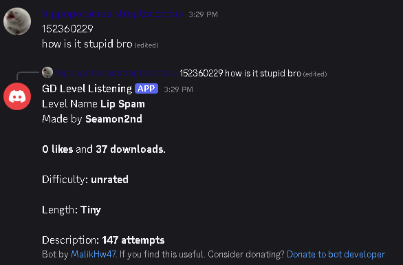

# GDlvl-discord-listening
Prints level data to a discord channel when it detects a gd level ID!

### "I don't understand coding shit I just wanna get it!"
[Here. Invite this. If the bot ain't online DM me on discord "malikhw"](https://discord.com/oauth2/authorize?client_id=1570809608191086622&permissions=68608&integration_type=0&scope=bot+applications.commands)
*(THIS Bot availability from this link will depend on whether my phone is online or no. so the best is to self host)*

## What it gets info about a level?
- Name
- Creator
- Star count
- Likes + Downloads
- Difficulty
- Length
- Description
- (Emojis soon)


## How to self Host?
1. Clone this repo locally
2. https://discord.com/developers/applications → New Application → Give it a name
3. Go to **Bot** tab. Turn on **Message Content Intent**. Copy Token. Make a new file named `.env` and paste `DISCORD_TOKEN=` and the copied token
4. Go back to the site. in Bot Permissions turn on "View Channels" "Send Messages" "View Message History"
5. Go to **OAuth** tab. Scroll down to URL Generator. Enable `bot` and `application.commands`. And under it Enable "View Channels" "Send Messages" "View Message History"(Again I know)
6. Copy generated URL. Open it to invite the bot to your server or send to a friend or whatever!

### How to run!
```python
pip install -r requirements.txt # tested against python 3.15.0
python main.py
```
And In the server do `/set_channel`
## Credits:
- MalikHw47: Dev (for https://crescent.hackclub.com)
- If you find this useful. Consider donating? https://malikhw.me/donate